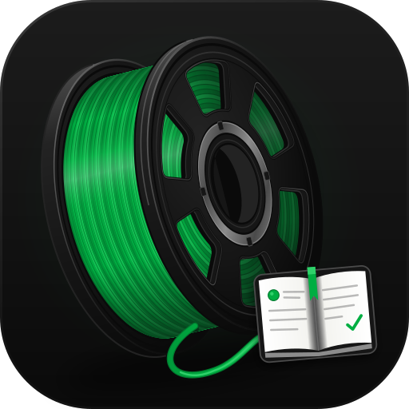
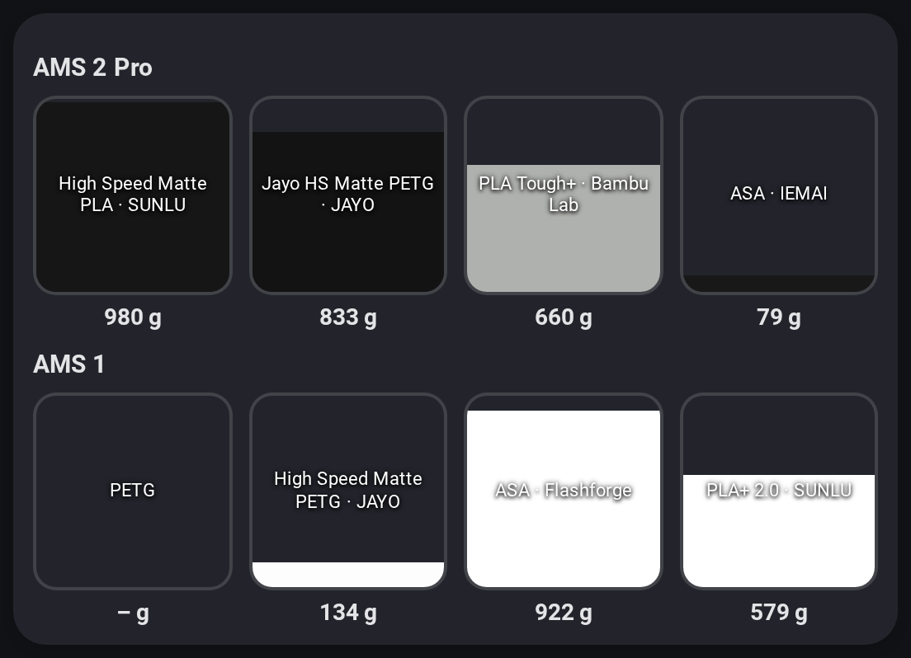
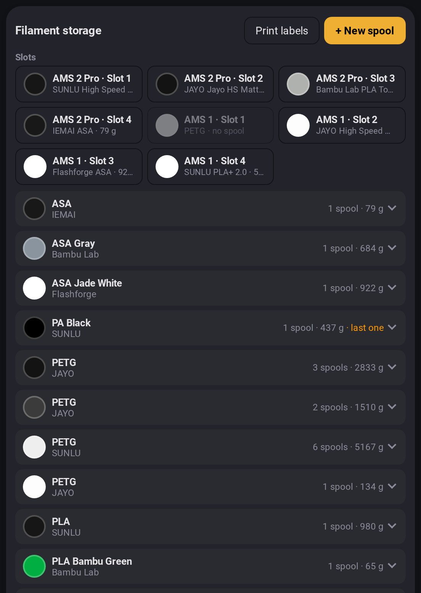
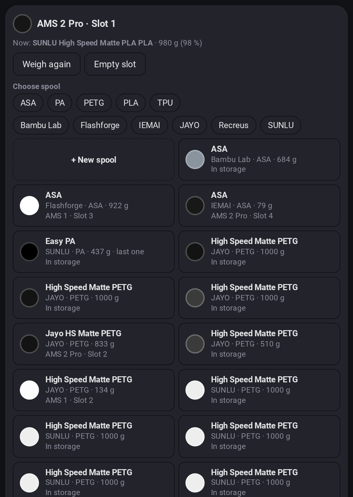
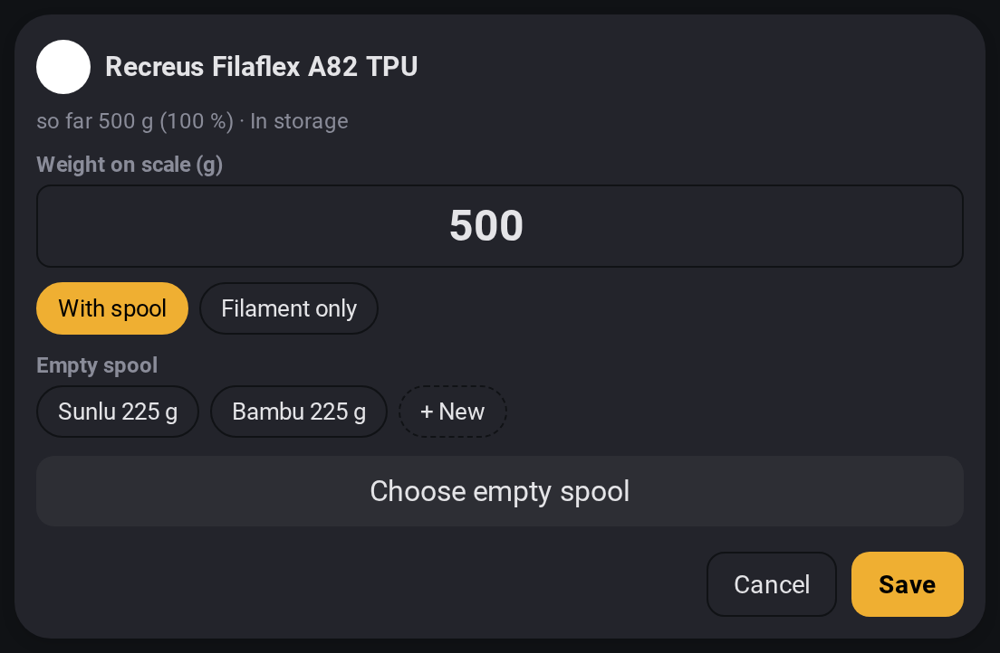
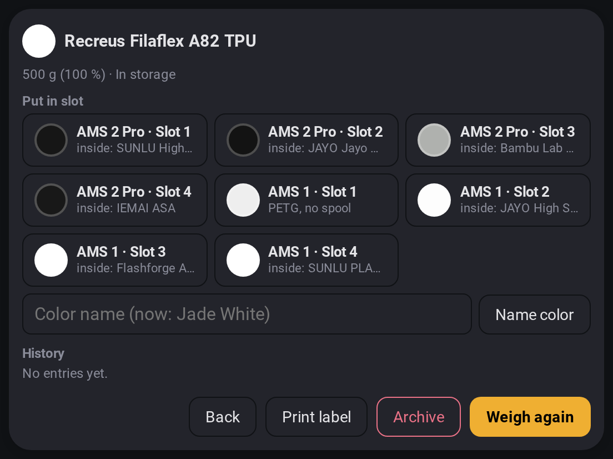
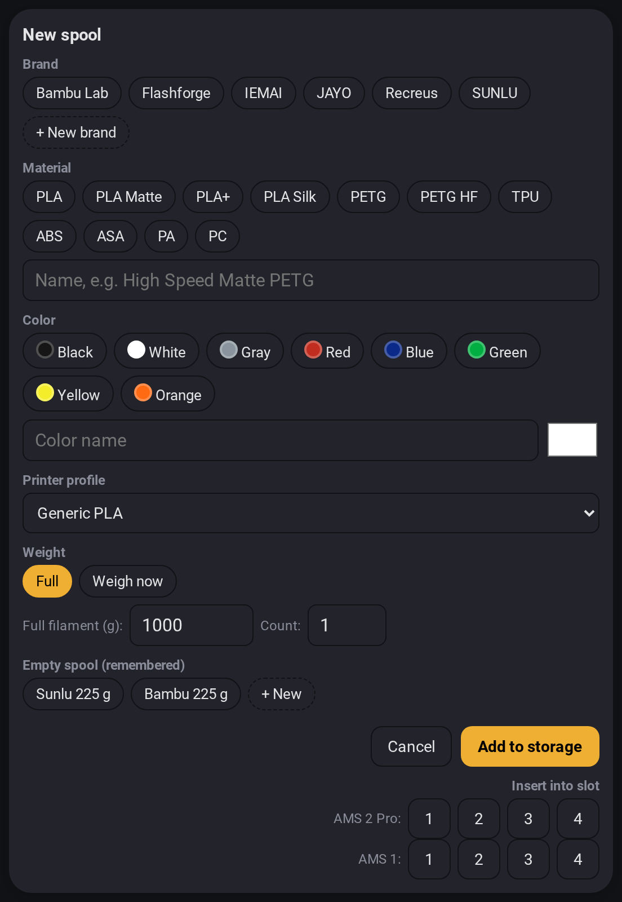
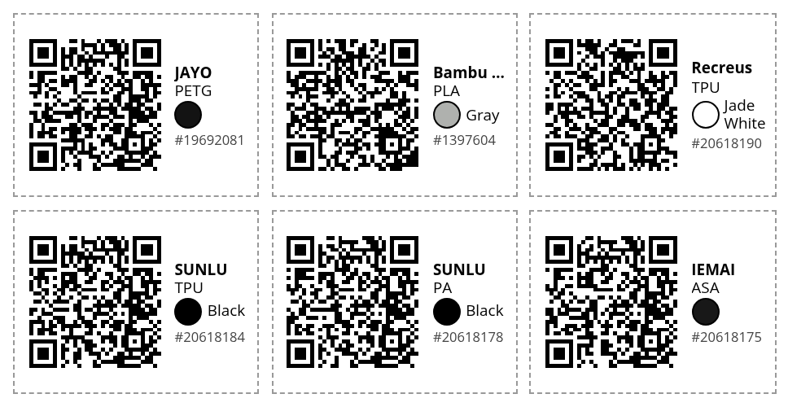

# Spoolbook

### Know every gram of filament you own.
**Your Bambu Lab AMS, alive in Home Assistant: every spool, every slot, every gram, live while you print.**

---

> ## 💸 Stop paying extra for "original" spools.
> **Any spool, any brand, the full Bambu experience.** Bambu only tracks its own RFID spools:
> name, colour, grams left, usage per print. Spoolbook gives **every third-party spool exactly
> the same**: it lives in your Bambu filament library, shows up in the AMS with its real
> colour, counts down live while you print and gets its usage booked afterwards. Buy the
> filament you like at the price you like, and lose nothing.

No spreadsheet. No guessing whether that grey PETG will last the night. No third-party
spool that Bambu "forgot" to count. Spoolbook shows your AMS exactly as it is, in the
spools' real colours, filled to exactly what is left, and **sinks live while you print**.
When the print is done, the grams land on the right spool by themselves.

<table>
  <tr>
    <td width="50%" valign="top">
      <h3>👀 See everything</h3>
      One glance: what is loaded, how much is left, which slot the printer is feeding from
      right now.
    </td>
    <td width="50%" valign="top">
      <h3>🔄 Swap in two taps</h3>
      Tap a slot, pick a spool from the shelf. Spoolbook sets the slot, binds the spool in
      your Bambu library and frees it from wherever it was.
    </td>
  </tr>
  <tr>
    <td valign="top">
      <h3>⚖️ Weigh, don't guess</h3>
      Put a spool on any kitchen scale and type the number. Spoolbook knows your empty
      spools and does the tare maths.
    </td>
    <td valign="top">
      <h3>📈 Counts every gram</h3>
      Live usage while printing, exact booking afterwards, and even cancelled prints are
      booked fairly. Third-party spools included.
    </td>
  </tr>
  <tr>
    <td valign="top">
      <h3>🏷️ Scan to find</h3>
      Print a QR label for every spool. Scan it with your phone and that exact spool opens,
      ready to load.
    </td>
    <td valign="top">
      <h3>🔔 Never run out</h3>
      A heads-up when the last spool of a material runs low, and a nudge when a slot is
      loaded with an unknown spool.
    </td>
  </tr>
</table>

## A closer look

<table>
  <tr>
    <td width="50%"></td>
    <td width="50%"></td>
  </tr>
  <tr>
    <td align="center"><b>Your whole shelf</b> grouped by material, colour and brand</td>
    <td align="center"><b>One window per slot</b> swap, weigh, unload, locked while printing</td>
  </tr>
  <tr>
    <td></td>
    <td></td>
  </tr>
  <tr>
    <td align="center"><b>Weighing</b> with or without the spool</td>
    <td align="center"><b>Every spool's story</b> weight, history, label, archive</td>
  </tr>
  <tr>
    <td></td>
    <td></td>
  </tr>
  <tr>
    <td align="center"><b>New spool in seconds</b> brand, material, colour, weight</td>
    <td align="center"><b>QR labels</b> 40 × 30 mm, scan to open</td>
  </tr>
</table>

## Why it just works

- ✅ **Uses the Bambu filament library you already have.** Nothing to migrate, nothing to
  self-host. Spools show up in Bambu Studio and the app too.
- ✅ **Lives entirely in Home Assistant.** Its own sidebar page, a card with a visual editor,
  a sensor per AMS slot for your automations and voice assistant.
- ✅ **Third-party spools are first-class.** Library entry, AMS colour, live grams, booking:
  the same as an RFID spool. (Setting the slot on the printer itself needs LAN mode or a
  bridge, see the [reference](docs/REFERENCE.md#what-needs-what).)
- ✅ **No YAML needed.** Add the card from the card picker and choose the view.
- ✅ **English and German** built in.

## Get started in three steps

1. **Install:** HACS → Custom repositories → `https://github.com/Infraviored/spoolbook`
   (Integration) → install **Spoolbook** → restart Home Assistant.
2. **Sign in:** Settings → Devices & services → Add **Spoolbook** → your Bambu account.
3. **Enjoy:** open **Spoolbook** in the sidebar, or add the Spoolbook card to any dashboard.

For the AMS overview and slot features, also install
[ha-bambulab](https://github.com/greghesp/ha-bambulab) for your printer.

## Want the details?

Options, actions, sensors, events, how usage is counted and what works in which printer
mode: **[the full reference](docs/REFERENCE.md)**.

## Credits

Started as a fork of [Timmes123/ha-bambu-filaments](https://github.com/Timmes123/ha-bambu-filaments)
(MIT, see `LICENSE`). AMS data comes from [ha-bambulab](https://github.com/greghesp/ha-bambulab).
Labels use the [QR Code generator](https://www.nayuki.io/page/qr-code-generator-library)
by Project Nayuki (MIT), bundled, no CDN.
